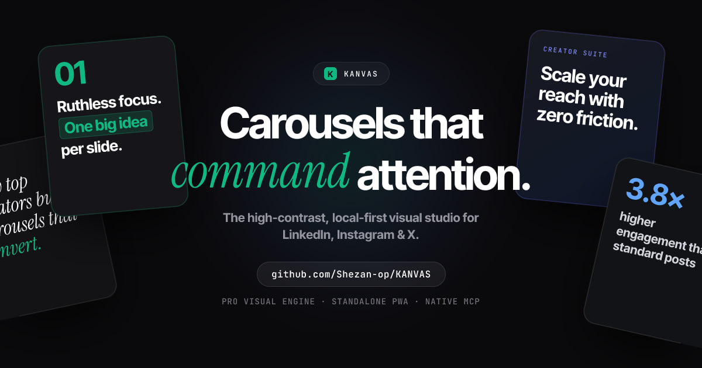

# KANVAS — Pro Visual Studio & Next-Gen Carousel Maker

<p align="center">
  
</p>

<p align="center">
  <strong>The High-Contrast, Apple-Grade Visual Engine for High-Converting Social Carousels & Decks.</strong><br />
  100% Local-First &bull; Offline PWA &bull; Zero External Tracking &bull; Native AI MCP Integration
</p>

<p align="center">
  <a href="#-quick-start"><strong>Quick Start</strong></a> &bull;
  <a href="#-live-example-carousels"><strong>Live Examples</strong></a> &bull;
  <a href="#-architectural-design-systems"><strong>Design Systems</strong></a> &bull;
  <a href="#-ai-agent-mcp-integration"><strong>AI Agent (MCP)</strong></a> &bull;
  <a href="#-features"><strong>Features</strong></a>
</p>

---

## ⚡ What is KANVAS?
**KANVAS** is a modern, standalone visual studio built for content creators, B2B founders, developers, and marketing agencies. It converts raw thoughts, articles, and prompt specs into pixel-perfect, publication-ready carousels formatted for **LinkedIn, Instagram, X (Twitter), and TikTok**.

- **Zero-Login & Complete Privacy:** All project data resides in local browser `IndexedDB`. Shared projects encode their full AST specification in compressed URL hash fragments (`#s=...`)—no content is stored on cloud databases.
- **Universal Device Freedom:** Designed with Apple Human Interface Guidelines (`/apple-hig` & `/vision-pro-ui`) for mobile, tablet, and desktop without device gates.
- **Native AI Agent Hub (MCP):** Embedded Model Context Protocol server exposing `create_carousel`, `update_carousel`, `get_carousel_guide`, and `read_carousel_link`.
- **Multi-Resolution Client-Side Exporter:** Instant export to 1×, 2×, and 3× PNGs, Instagram JPGs, multi-page LinkedIn PDFs, or bundled ZIP archives.

---

## 🚀 Live Example Carousels

Click any example to open and edit directly in KANVAS (encoded via client-side `#s=` state):

| Template | Topic & Headline | Instant Link |
| :--- | :--- | :--- |
| **KANVAS Obsidian** | *Why Category Creators Win 80% of the Market* | [Open Obsidian Deck](https://trykanvas.app/c/the-5-laws-of-position-power#s=XZJbaxtBDIX_ihDkxUxMkjol7FOTQCn05uK2oZRStDuyd7qzo2VGY2cJ_u9l1rm4fR0d6Xw6mgdUp56xwq8twyV8oF0CWcNSklMnAZay44gGlfvBkxal1MlZRwENriX2pFjhorpEgwN51knTUdhSOrUUu0kWNGGFvViOpa-OFCxWDxioL_L315--X69gGQUNthTshPTmMGWeNFsnuDeYvLOcsPr5gJ5GycW6ke1E2Lmm44gV3pThcB2b1ik3miMX_sc179oRbkl5I3GE28ikEhPM7lyAq7OTWdldW4aPFDvWORpMuT6OaHgMxoUNrCP1vJPYQU5soR6nVpUBzk_muDdHkIO4oGgw5L4ukOcvRKvSsGLvy8jZW6ZCnGYlJbEjVvj0BBQZGul7sU4dp_nLldYSISlpTgaiSx2wd70LVIoGShzN085WSiE0_B9haUeDW_K5UF3NF_do0FPNHit85zYtx-I-UBihqKbhsGs5PIfCFigBvZg1h4BhyzHlUkmy1l3ZQ0X8FK_k2BTDpacRbtxmwxEuzi5e_0vXKB0d8SY7b2GUHCHwvT77nVpeu-k0DUXJiT3snLZw-F7Frs6qErDCzwMHWD1-rF8GnS0ZvFp8-bb48ftPSCvc_wU) |
| **Spatial Glass** | *Designing for the Eyes and Hands (visionOS)* | [Open Spatial Deck](https://trykanvas.app/c/spatial-computing-visionos-interface-design#s=XZJLjxNBDIT_iuUDh2gSseIhMSeiEHZXBJA2aA8gDp4eJ9PaHvfQdkcaovx31HmxcG2VXV9Ve4_mLTDWuB7IPAVYxH7I5mULL-DRq4_ydQ33Ypw25Bg-sPqtYIXG_RDIyqieRrHCTUw9Gdb4un6DFQ4U2I4SNzacptxzotAehWKKNRq7DitsEkmL9R6F-iL_NP_yOF_D-rq4I2mPmO_PZrPs8VChBt-yYv1jj4HGmIu3iztOWOGTd0-csMbdJcYybaPE3jstAc7BT4lgExNYxzBZjqxA0sIdSauzCVaoubmoX4EvXZAzHwVSDqzH0TMWuEt9MzxUz6CG6MWwQsl9U6Bu_gIsohiLwUef1CqY3AZShQd23LIW-ya2I9Z4evcKBGopO8uJAgyBhCuQaNCyi4kK2AxWbND5bTd1USyRGmTlBO7spZ0X_g9RjQrhjkIuWG9f9qWmQA0HrPEbpS0bbOk3Ty1OlQOfOihHIG4Ei9CTFyMv4EPIpXOIG0hMwds4Kz3GnFzZPR-GwHB3f3v94n9InNGzD1ok2ti14CGxstgxpkIUON1KWd9ksyhY44qyuA4WJDtSPPys0LflKL9_tl-rm_7dw3LEwx8) |
| **Minimalist Mono** | *Subtract Until Nothing is Left to Remove* | [Open Minimalist Deck](https://trykanvas.app/c/ruthless-minimalism-in-modern-saas#s=XZJPbxNBDMW_iuVjtKqEKJc9EUEl_rWghvaCOHh3vFnT2fHi8SREVb47mm2jFI6jefb7-dmP6OKRscXb4mPknOFakkwUJU8gCa41sCXYEG2wQedpjuRVP51kjg0OahM5tnjZvsEGZ4rsTypNuvwnz8uzdsMGO6MUsH3ERFPVfV7f3K83cBXE1YQiNjhSCgvZ22eri0yU8dhgjhI4Y_vjESMdtFTjXnds2OCD9A9s2OI301B6h6u0lcRskrZ1gOdpN6Vzo97hLrlEWN2oj5K2K5AMX3hwcIVbnnTHF9hgLt2p8PvIsHHeMXzSLsPEPmqAQQ04OdtskhmyDr4n4ws8Ni8YZ5VU00pl6irjqzPPx5TdSu-iKcPaGFbrWaNuhfOqxqXhUFUDHLQYlMwGUv0G6hmMfxcxzkDgqtFlBjWgBJo6JQuStrCn-OCjadmODRgHzrJN4CPDEHX_H2h2qpw7iqXCva4TzxkbjNRxxBav6Y9MZQKKUffURYbBZKGHjn3PnM6MyYFSgL5k14kNlq4QOMqO7bDEq8X6ZSvnYN8_AW6cUiAL__L1Ti92-c6YnOF8kMCnM4KeTEvmmGEvPsLTmVXPrrhrwha_zlxtShDF488GJVSQy_vS_Rrubv2D4PEv) |

---

## 🎨 Architectural Design Systems

1. **KANVAS Obsidian:** Deep OLED dark background (`#0E0E10`), hairline structural borders (`rgba(255,255,255,0.08)`), high-contrast white headlines, and emerald `#10B981` accents.
2. **Spatial Glass (Apple Vision Pro Inspired):** Luminescent borders, frosted glass textures (`backdrop-filter: blur(20px)`), and floating ornaments.
3. **Minimalist Mono:** Pure document-grade typographic discipline. High contrast, warm paper/bone tones, and zero visual clutter.
4. **Editorial & Swiss:** Classic serif and typographic poster aesthetics.

---

## 🛠️ Quick Start

```bash
# Clone repository
git clone https://github.com/Shezan-op/KANVAS.git
cd KANVAS

# Install dependencies
npm install

# Run local development studio
npm run dev
```

Open [http://localhost:3000](http://localhost:3000) (or `http://localhost:3030`) to launch KANVAS.

---

## 🤖 AI Agent MCP Integration

KANVAS includes a native Model Context Protocol server. Connect it directly to your agent environment:

```bash
# Local development
claude mcp add --transport http kanvas http://localhost:3000/mcp

# Deployed production
claude mcp add --transport http kanvas https://your-kanvas-deployment.app/mcp
```

### Exposed MCP Tools:
- `create_carousel`: Takes a structured JSON spec and returns an instant browser link.
- `update_carousel`: Revises an existing project without duplicating files.
- `get_carousel_guide`: Full JSON schema documentation and field reference.
- `read_carousel_link`: Deserializes any KANVAS `#s=` URL into raw JSON.

---

## 📄 License

MIT License &copy; 2026 KANVAS Studio & Shezan.
